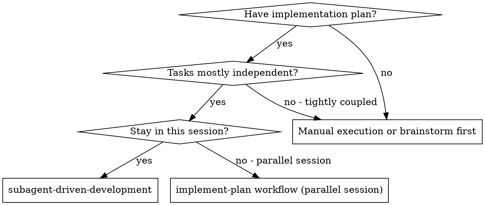
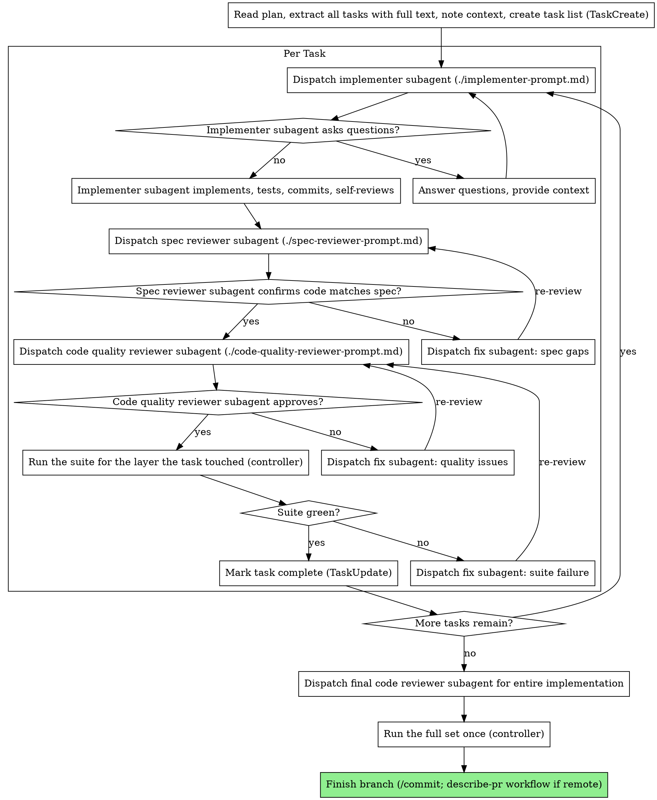

# Subagent-Driven Development

Execute plan by dispatching fresh subagent per task, with two-stage review after each: spec compliance review first, then code quality review.

**Why subagents:** You delegate tasks to specialized agents with isolated context. By precisely crafting their instructions and context, you ensure they stay focused and succeed at their task. Start each one with a fresh context window; it never inherits your session's context or history — you construct exactly what it needs. (A runtime that forks the conversation by default, such as Codex, is told to start fresh.) This also preserves your own context for coordination work.

**Core principle:** Fresh subagent per task + two-stage review (spec then quality) = high quality, fast iteration. The review scales with the task (see "Fixing Review Issues"): a mechanical task gets one combined pass, and a trivial fix is yours to apply.

**Continuous execution:** Do not pause to check in with your human partner between tasks. Execute all tasks from the plan without stopping. The only reasons to stop are: BLOCKED status you cannot resolve, ambiguity that genuinely prevents progress, or all tasks complete. "Should I continue?" prompts and progress summaries waste their time — they asked you to execute the plan, so execute it.

## When to Use

**vs. Executing Plans (parallel session):**
- Same session (no context switch)
- Fresh subagent per task (no context pollution)
- Two-stage review after each task: spec compliance first, then code quality
- Faster iteration (no human-in-loop between tasks)

## The Process

## Model Selection

Use the least powerful model that can handle each role to conserve cost and increase speed.

**Mechanical implementation tasks** (isolated functions, clear specs, 1-2 files): use a fast, cheap model. Most implementation tasks are mechanical when the plan is well-specified.

**Integration and judgment tasks** (multi-file coordination, pattern matching, debugging): use a standard model.

**Architecture, design, and review tasks**: use the most capable available model.

Concretely, in this harness: cheap = `sonnet`, standard and most capable = `opus`. Always pass `model` explicitly; an omitted `model` inherits the session model, and session models (Fable, Astra) plan and review but never implement.

**Task complexity signals:**
- Touches 1-2 files with a complete spec → cheap model
- Touches multiple files with integration concerns → standard model
- Requires design judgment or broad codebase understanding → most capable model

## Waves: how many implementers to run at once

The per-task loop above never changes. What varies is how many tasks are in flight.

Before each dispatch, look at the remaining tasks. A task is **ready** when every task in its `Depends on` is complete. Two ready tasks are **independent** when their `Files` lists don't overlap **and** neither defines something the other consumes (a type, a message format, an API). Different files are not enough: a consumer dispatched beside its producer builds against a moving target. Either sequence the pair, or treat the interface as frozen because the plan already states it exactly. If a review changes a shared interface mid-wave, stop and re-brief the implementer that consumes it before it reports. A **wave** is a set of ready, independent tasks.

Decide per wave, and say which you chose in one line. Don't ask.

- **Run the wave concurrently** when it saves real time: two or more substantial tasks, each worth its own implementer, whose reviews can proceed on their own.
- **Run one at a time** when tasks are small (one dispatch that lists all the small edits beats several concurrent agents), when a task changes an interface a later task consumes, when the plan's file lists look uncertain, or when the tasks would edit the same regions even if the file lists differ.

Mechanics of a concurrent wave:

1. Every worktree starts from the plan branch's head, never from the default branch; earlier tasks' merged work is the base the wave builds on. `isolation: "worktree"` gives you that only when `worktree.baseRef` is `"head"` in settings; otherwise, or when the repo is not the session's cwd root, or when packages need a build step to resolve each other, create the worktrees by hand (`git worktree add`) and put the setup commands in each brief. Then dispatch every implementer of the wave in one message, each with a `model` chosen per task. Put the test-file rule in every brief. Before a wave of three or more on a laptop, check memory in use; a suite set costs a few GB on a heavy repo, and reviewers' runs count too.
2. Run the spec and quality reviews per task, as usual, against that task's branch, as each implementer reports; don't wait for the whole wave. Fix subagents work in the same worktree. The reviews, not the implementers, are what fill your context in a wave: keep the review prompts self-contained and let the templates' short verdict format do its job.
3. When a task passes both reviews, merge its branch into the plan branch and run the suite for the layer the task touched (`../tdd/tdd.md`, How Much to Run); the full set runs once, before the branch merges. Resolve conflicts yourself. A conflict means a `Files` list was incomplete; note it in the plan.
4. **Shared files are yours, not the implementers'**: `CLAUDE.md`, `CONTEXT.md`, `docs/adr/`, the plan file and its checkboxes, the task list. Implementers report what should change there; you apply `CONTEXT.md`, ADR, and plan updates after the merge, and collect the `CLAUDE.md` notes to run `write-claude-md` once after the phase rather than editing it per merge.
5. Start the next wave after the merge, since its tasks may depend on what just landed.

## Handling Implementer Status

Implementer subagents report one of four statuses. Handle each appropriately:

**DONE:** Proceed to spec compliance review.

**DONE_WITH_CONCERNS:** The implementer completed the work but flagged doubts. Read the concerns before proceeding. If the concerns are about correctness or scope, address them before review. If they're observations (e.g., "this file is getting large"), note them and proceed to review.

**NEEDS_CONTEXT:** The implementer needs information that wasn't provided. Provide the missing context and re-dispatch.

**BLOCKED:** The implementer cannot complete the task. Assess the blocker:
1. If it's a context problem, provide more context and re-dispatch with the same model
2. If the task requires more reasoning, re-dispatch with a more capable model
3. If the task is too large, break it into smaller pieces
4. If the plan itself is wrong, escalate to the human

**Never** ignore an escalation or force the same model to retry without changes. If the implementer said it's stuck, something needs to change.

## Fixing Review Issues

When a reviewer (spec or quality) returns issues, **dispatch a fresh fix subagent** — do not assume you can resume the implementer. There is no reliable way to continue a previous agent's session, so re-feed the fix subagent what it needs: the original task text, what was built, the reviewer's specific findings, and the file paths / commit range. Then re-run the *same* reviewer on the result and repeat until it approves. (In this harness, re-review by continuing the same reviewer with `SendMessage` instead of dispatching a fresh one; it already holds the task and the first findings. Fall back to a fresh reviewer if the agent is gone.) A fix subagent reruns only the test files it touched plus what the reviewer named; the controller's run after the merge covers the rest.

**Scale the review to the task.** The two stages exist because a reviewer who checks the spec and one who checks the code find different things, and that holds for any task with judgment in it. Two cases are cheaper without losing that:

- A **mechanical task** (the cheap-model tier above: one or two files, a complete spec) gets one reviewer: dispatch the code-quality reviewer with the task text included and ask it to verify spec compliance first, then quality, in one pass. Its verdict covers both stages.
- A **trivial, unambiguous fix** from a finding (a typo, a missed import, a renamed identifier, a one-line condition the reviewer spelled out) you apply yourself and note in the task list, then re-review. A fix subagent is for anything that takes judgment or more than a few lines; the reason is that your context fills with the work's detail, not that you may not touch the code.

The two stages pull in opposite directions by design: the **spec** stage rewards YAGNI (build only what was asked); the **quality** stage rewards robustness (the edge cases and failures the requirements name, handled properly). Robustness is not more code: a quality reviewer flags defensive extras and speculative generality as readily as missing checks. When a quality reviewer proposes work beyond the spec, that tension is expected — apply it if it's cheap and clearly right, otherwise push back with reasoning (see `requesting-code-review`).

## Prompt Templates

- `./implementer-prompt.md` - Dispatch implementer subagent
- `./spec-reviewer-prompt.md` - Dispatch spec compliance reviewer subagent
- `./code-quality-reviewer-prompt.md` - Dispatch code quality reviewer subagent

## Rules the process does not state on its own

- Start on a branch, not main or master, unless the user said otherwise: the plan may be abandoned or reordered, and a review finding may mean reverting a task.
- Give the implementer the task's full text and the scene-setting context in the prompt. It starts with a fresh context window and cannot resolve the plan file or skill paths.
- Spec review before quality review, and a task is complete only when both have approved the current code. A quality reviewer's "approve" on code that then changes for a spec gap is void.
- The implementer's self-review is a filter, not a review; both stages still run (or the combined pass for a mechanical task).
- For fan-outs that are not plan tasks, use the `dispatching-parallel-agents` skill instead of this workflow's waves.

## Integration

**Required workflow:**
- **Worktree isolation** - Every implementer in a concurrent wave gets `isolation: "worktree"`; a lone implementer may work in the plan branch directly
- **[create-plan workflow](../create-plan/create-plan.md)** - Creates the plan this workflow executes
- **[requesting-code-review workflow](../requesting-code-review/requesting-code-review.md)** - Reviewer subagent template used by the code-quality stage ([code-reviewer.md](../requesting-code-review/code-reviewer.md))
- **`/commit`** (commit any uncommitted work) + **[describe-pr workflow](../describe-pr/describe-pr.md)** (only if the repo has a remote/PR; otherwise just summarize) - Finish the branch after all tasks

**Alternative workflow:**
- **[implement-plan workflow](../implement-plan/implement-plan.md)** - Parallel-session execution instead of same-session
